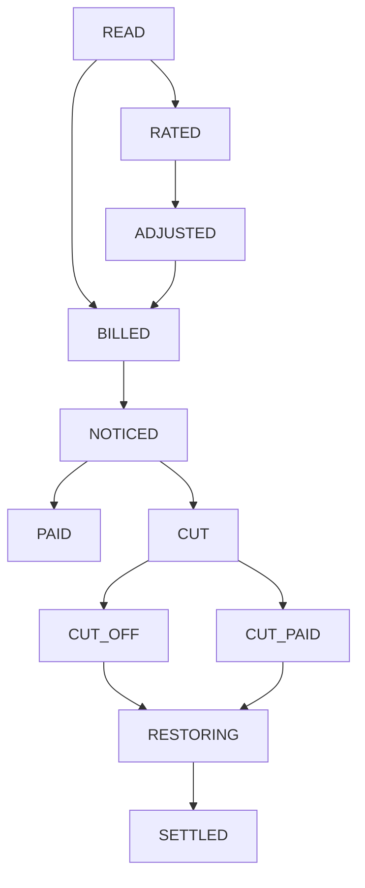
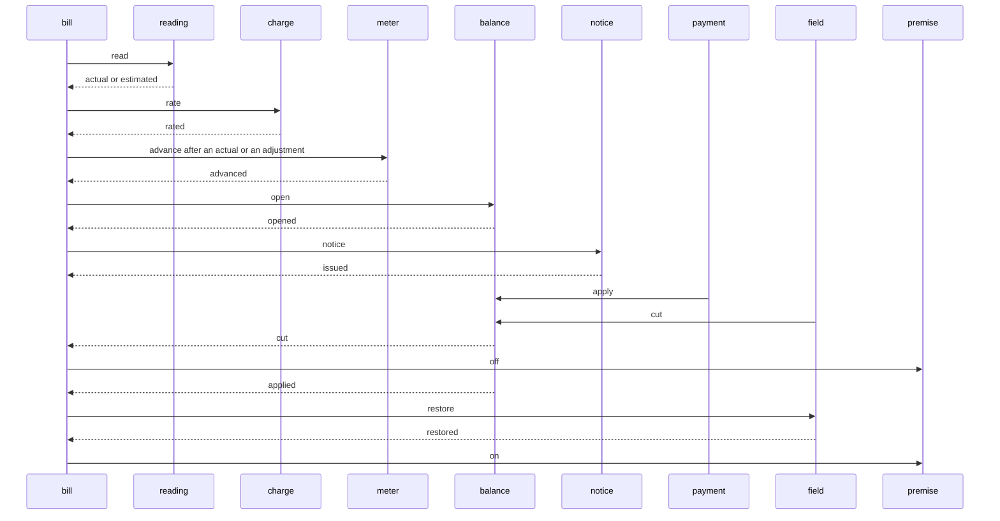

# Meter to Cash

A reader takes a meter dial, rates the kilowatt-hours, and opens a balance. Thirteen services each own one Postgres database. The bill service is the saga orchestrator. It does not call the others over HTTP. A step commits its own row and an outbox message in one local transaction. A relay publishes that message. The next service claims an inbox key before it writes. Disconnecting a premise is a new field order. Paying a cut bill later is a new reconnect. Neither one rolls the other back.

The balance service is the only writer of the open amount. A payment subtracts only while the row is still open or cut and the open amount still covers the tender. A disconnect marks the row cut only while it is still open and the amount is still above zero. Two tenders for the full amount leave one applied and one short.

An estimated route rates the dial it was given and waits. A later actual reading posts the difference before a notice goes out. Previous dial 1000, estimated dial 1200, and 10 cents per kilowatt-hour rates 200 kilowatt-hours at 2000 cents. An actual dial of 1100 posts an adjustment of -1000 cents, and the open balance is 1000 cents. The meter stays on 1000 until that adjustment is posted.

A reading behind the previous dial cancels before a charge. A dial that does not move cancels empty. A price that overflows the integer range cancels and rewinds the dial when it already moved. A tender whose token ends in `0000` is declined and dead-lettered, with no payment row. A meter whose seal text contains `sealed` refuses the cut and dead-letters, and the premise stays on.





The relay can publish a message and crash before it marks the row sent. The broker then holds a second copy. Consumers dedupe with the inbox key. The saga moves a bill forward only from the status that step expects, so a repeated fact does not apply twice. There is no distributed transaction.

## Services

| Service | Owns | Port |
| --- | --- | --- |
| account-service | the customer | http://localhost:8241 |
| premise-service | the service address and whether it is on | http://localhost:8242 |
| meter-service | the device and the last dial | http://localhost:8243 |
| reading-service | an actual or estimated consumption | http://localhost:8244 |
| tariff-service | cents per kilowatt-hour | http://localhost:8245 |
| charge-service | consumption times the rate | http://localhost:8246 |
| bill-service | the bill and the saga | http://localhost:8247 |
| adjustment-service | the estimate true-up | http://localhost:8248 |
| notice-service | the notice after the balance is open | http://localhost:8249 |
| balance-service | the open amount | http://localhost:8250 |
| payment-service | the tender | http://localhost:8251 |
| field-service | the cut and the later reconnect | http://localhost:8252 |
| audit-service | one row per fact | http://localhost:8253 |

Postgres is `localhost:5445`. Kafka's host listener is `localhost:9106`. RabbitMQ management is http://localhost:15685.

## Run

```bash
mvn -q -DskipTests package
docker compose up --build -d
./scripts/smoke.sh
docker compose down
```

```bash
curl -s -X POST localhost:8241/accounts \
  -H 'content-type: application/json' \
  -d '{"accountNumber":"A-1","name":"North"}'

curl -s -X POST localhost:8242/premises \
  -H 'content-type: application/json' \
  -d '{"premiseCode":"P-1","accountId":"ACCOUNT","address":"12 Elm"}'

curl -s -X POST localhost:8243/meters \
  -H 'content-type: application/json' \
  -d '{"serial":"M-1","premiseId":"PREMISE","lastRead":1000}'

curl -s -X POST localhost:8245/tariffs \
  -H 'content-type: application/json' \
  -d '{"code":"R-10","rateCents":10}'

curl -s -X POST localhost:8247/bills \
  -H 'content-type: application/json' \
  -d '{"requestId":"bill-1","accountId":"ACCOUNT","premiseId":"PREMISE","meterId":"METER","tariffId":"TARIFF","readValue":1100,"route":"ROUTE-1"}'
```

The same `requestId` returns the original bill and does not read the dial again. A move from 1000 to 1100 at 10 cents is 1000 cents. After the notice, a tender pays that open amount and the premise stays on.

## Where the same split goes on Azure

This repository runs on Compose. Nothing in it calls a cloud account.

| Compose | Azure |
| --- | --- |
| Postgres 16 | Azure Database for PostgreSQL |
| Kafka 3.8 | Event Hubs |
| RabbitMQ 3.13 | Service Bus queue, with its dead-letter sub-queue |
| the thirteen services | Container Apps or AKS |

## Local credentials

The Compose network is local and unauthenticated. Do not publish these ports.

| | |
| --- | --- |
| Postgres | `platform` / `platform` |
| RabbitMQ | `platform` / `platform`, vhost `/` |
| HTTP | no authentication |

## Tests

`mvn test` checks a reading behind the dial, an integer overflow of consumption times the rate, the estimate true-up of 1200 then 1100 at 10 cents, a sealed meter, and a payment token that ends in `0000`. `./scripts/smoke.sh` rates a reading and collects it, true-ups an estimate before the notice, cancels a bad dial, an empty dial, and a price overflow, dead-letters a declined tender and a sealed meter, cuts service and restores it when the bill is paid, and runs two overlapping cases: two tenders for the full open amount, and a tender racing a disconnect.

## Same shape, different domain

- [Live Lobby](https://github.com/joshbarros/java-live-lobby)
- [Loyalty Ledger](https://github.com/joshbarros/java-loyalty-ledger)
- [Claims Desk](https://github.com/joshbarros/java-claims-desk)
- [Checkout Counter](https://github.com/joshbarros/java-checkout-counter)
- [Study Hall](https://github.com/joshbarros/java-study-hall)
- [Clearing Desk](https://github.com/joshbarros/java-clearing-desk)
- [Thread Hall](https://github.com/joshbarros/java-thread-hall)
- [Yard Gate](https://github.com/joshbarros/java-yard-gate)
- [House Account](https://github.com/joshbarros/java-house-account)
- [Procure to Pay](https://github.com/joshbarros/java-procure-to-pay)
- [Policy Bind](https://github.com/joshbarros/java-policy-bind)
- [Plant Order](https://github.com/joshbarros/java-plant-order)
